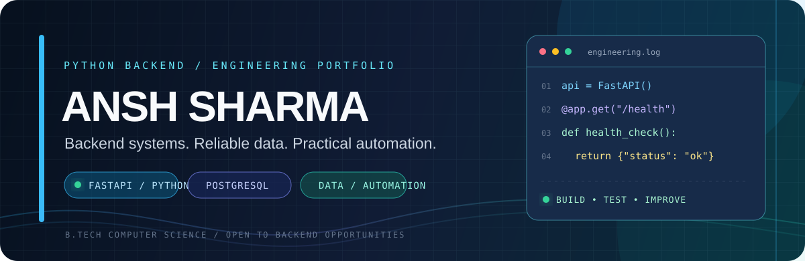

<div align="center">



<a href="https://github.com/AnshSharma16"></a>
<a href="https://www.linkedin.com/in/ansh-sharma-a9a689284/"></a>


<a href="https://readme-typing-svg.demolab.com?font=JetBrains+Mono&weight=600&size=19&pause=1000&color=38BDF8&center=true&vCenter=true&width=720&lines=Designing+Python+backend+systems;Building+APIs+with+FastAPI;Working+with+PostgreSQL+%26+SQLAlchemy;Turning+ideas+into+tested+software">

</a>

**B.Tech Computer Science Graduate · Python Backend Development · AI Automation**

</div>

---

<table>
<tr>
<td width="58%" valign="top">

## `01 / PROFILE`

I build practical backend systems with an emphasis on **clear architecture, reliable data handling, and testable behavior**.

- 🐍 **Core:** Python, FastAPI, REST API development
- 🗄️ **Data:** PostgreSQL, SQLAlchemy, Pandas, Pydantic
- ⚙️ **Engineering:** AsyncIO, transactions, validation, retries, logging
- 🧪 **Quality:** Pytest, Ruff, unit and integration testing
- 🎯 **Open to:** Entry-level Python Developer, Backend Developer, and AI Automation roles

</td>
<td width="42%" valign="top">

## `02 / CURRENT FOCUS`

```yaml
role: Python Backend
building:
  - REST APIs
  - ETL pipelines
  - workflow systems
learning:
  - Docker
  - CI/CD
  - Linux
principles:
  - test first
  - measure behavior
  - design for failure
```

</td>
</tr>
</table>

## `03 / TECHNOLOGY RADAR`

<div align="center">

**LANGUAGES & BACKEND**


**DATABASES & DATA**


**TOOLS & ENVIRONMENT**


</div>

| Discipline | Tools / concepts |
|---|---|
| **Programming** | Python, SQL |
| **Backend** | FastAPI, REST APIs, Pydantic, Uvicorn, AsyncIO |
| **Persistence** | PostgreSQL, SQLite, SQLAlchemy 2.x, Alembic |
| **Data & ML** | Pandas, NumPy, scikit-learn, TF-IDF, LinearSVC |
| **Testing & quality** | Pytest, pytest-cov, Ruff, mocking, integration tests |
| **Engineering practices** | Layered architecture, dependency injection, transactions, logging, pagination, retries |
| **Tools** | Git, GitHub, Docker, Docker Compose, GitHub Actions |

---

## `04 / SELECTED BUILDS`

<div align="center">

<table>
<tr>
<td width="50%" valign="top">

### ⚙️ AI Workflow Automation Platform

A backend platform for defining and executing workflows represented as connected nodes and edges.

- 🔀 Workflow graph validation and conditional branching
- ⚡ Asynchronous execution and per-node tracking
- 🔐 JWT authentication and workspace authorization
- 🔁 Retry handling with exponential backoff and jitter

**Stack**  
`Python` `FastAPI` `PostgreSQL` `SQLAlchemy` `Alembic` `Docker`

[](https://github.com/AnshSharma16/ai-workflow-platform)

</td>
<td width="50%" valign="top">

### 🔔 Distributed Notification Engine

An asynchronous notification service that accepts requests, dispatches channel deliveries, and tracks delivery status.

- 📬 Email, SMS, push, and webhook adapter design
- ⚡ Background processing and timeout handling
- 🔁 Retry manager with exponential backoff and jitter
- 🗄️ PostgreSQL persistence and dependency injection

**Stack**  
`Python` `FastAPI` `PostgreSQL` `Async SQLAlchemy` `Pydantic`

[](https://github.com/AnshSharma16/notification-engine)

</td>
</tr>
<tr>
<td width="50%" valign="top">

### 🧰 DataForge / ETL Pipeline

A modular ETL pipeline for CSV ingestion, customer-data cleaning, schema validation, invalid-record reporting, and optional PostgreSQL loading.

- 📥 CSV ingestion and cleaning with Pandas
- ✅ Pydantic validation with row-level error details
- 🗄️ SQLAlchemy loading with conflict-aware upserts
- 📊 Data-quality metrics and structured logging
- 🧪 Latest recorded run: **25 tests passed · 97% coverage**

**Stack**  
`Python` `Pandas` `Pydantic` `SQLAlchemy` `PostgreSQL` `Pytest`

[](https://github.com/AnshSharma16/DataForge)

</td>
<td width="50%" valign="top">

### 📋 FastAPI Job Tracker API

A REST API for creating and retrieving job application records.

- 🚀 Job creation and retrieval endpoints
- ✅ Request validation with FastAPI / Pydantic
- 🗄️ Persistent storage using SQLAlchemy and SQLite
- 📖 Interactive API documentation through Swagger UI

**Stack**  
`Python` `FastAPI` `SQLAlchemy` `SQLite` `REST`

[](https://github.com/AnshSharma16/fastapi-jobtracker-api)

</td>
</tr>
<tr>
<td width="50%" valign="top">

### 🧠 InsightFlow / Sentiment Analysis

An NLP project that classifies customer reviews and explores sentiment patterns in Amazon review data.

- 🧹 Text preprocessing and normalization
- 🔎 TF-IDF with unigram and bigram features
- 🤖 Sentiment classification using LinearSVC
- 📊 Streamlit interface for predictions and batch CSV processing

**Stack**  
`Python` `Pandas` `scikit-learn` `TF-IDF` `LinearSVC` `Streamlit`

[](https://github.com/AnshSharma16/InsightFlow2)

</td>
<td width="50%" valign="top">

### 🦠 COVID Survival Span

An educational machine-learning application for exploring COVID-19 patient data and predicting survival outcomes from patient attributes.

- 🧬 Patient-input prediction interface
- 📊 Exploratory analysis of age, demographics, comorbidities, and outcomes
- 📈 Visualizations using Matplotlib, Seaborn, and Plotly
- 🖥️ Interactive Streamlit application

**Stack**  
`Python` `Pandas` `NumPy` `scikit-learn` `Streamlit` `Plotly`

[](https://github.com/AnshSharma16/CovidSurvivalSpan)

</td>
</tr>
</table>

</div>

---

## `05 / GITHUB TELEMETRY`

<div align="center">

<a href="https://github.com/AnshSharma16">

</a>
<a href="https://github.com/AnshSharma16">

</a>

<br/>


<br/>


</div>

<sub>Stats and graph widgets are generated by third-party services and may be delayed or unavailable. Repositories and commit history remain the source of truth.</sub>

---

<table>
<tr>
<td width="50%" valign="top">

## `06 / ENGINEERING VALUES`

- 🧱 **Structure:** separate API, business logic, and persistence.
- 🛡️ **Reliability:** validate inputs and handle failures explicitly.
- 🧪 **Evidence:** test success paths, edge cases, and failures.
- 📈 **Measurement:** use metrics and benchmarks instead of assumptions.

</td>
<td width="50%" valign="top">

## `07 / CONTACT`

Open to conversations about Python backend development, APIs, data systems, and automation.

<a href="https://github.com/AnshSharma16"></a>

<a href="https://www.linkedin.com/in/ansh-sharma-a9a689284/"></a>

</td>
</tr>
</table>

<div align="center">

### `BUILD  →  TEST  →  MEASURE  →  IMPROVE`

</div>
